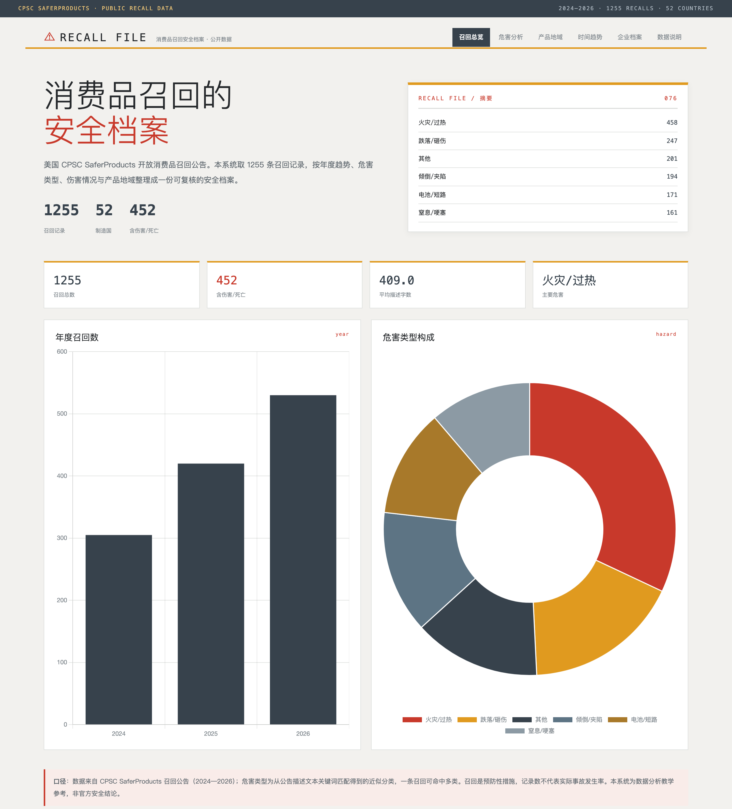
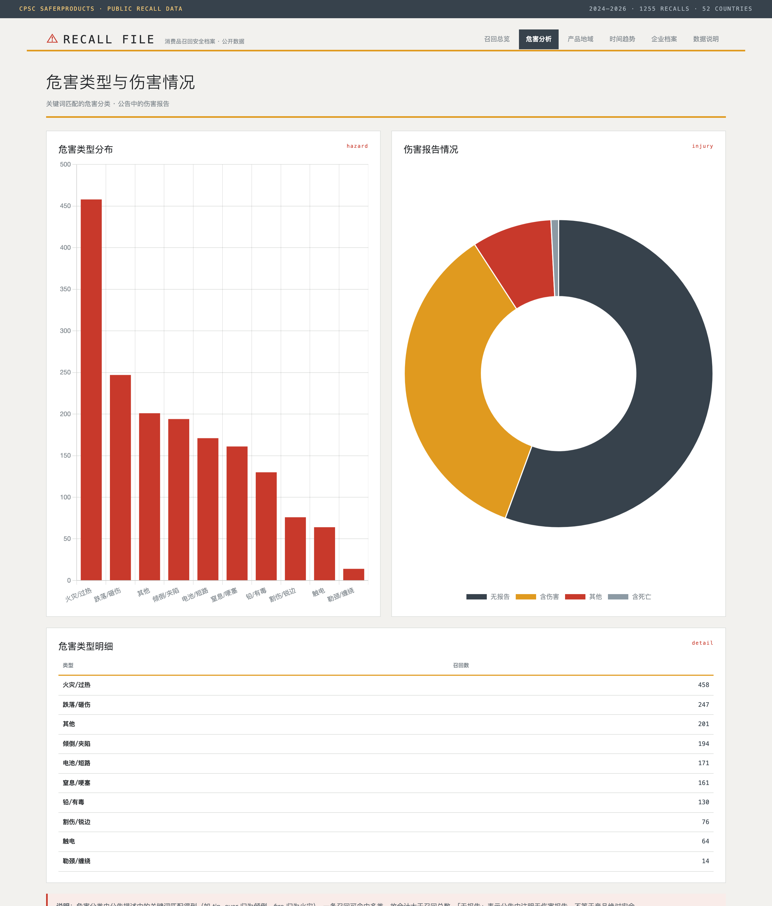
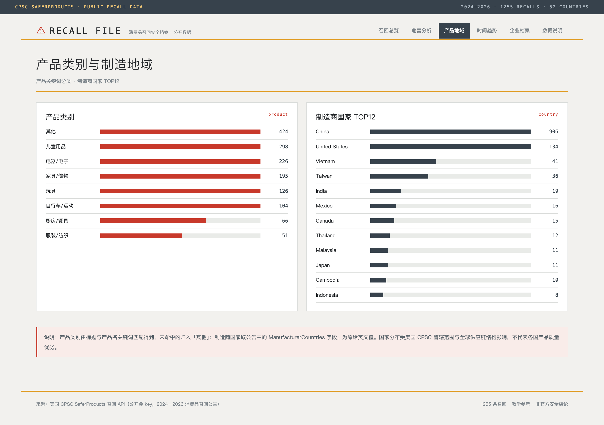
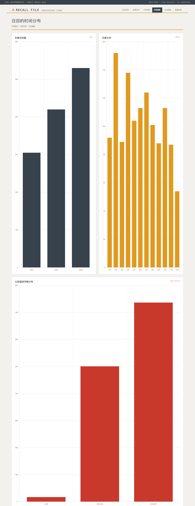
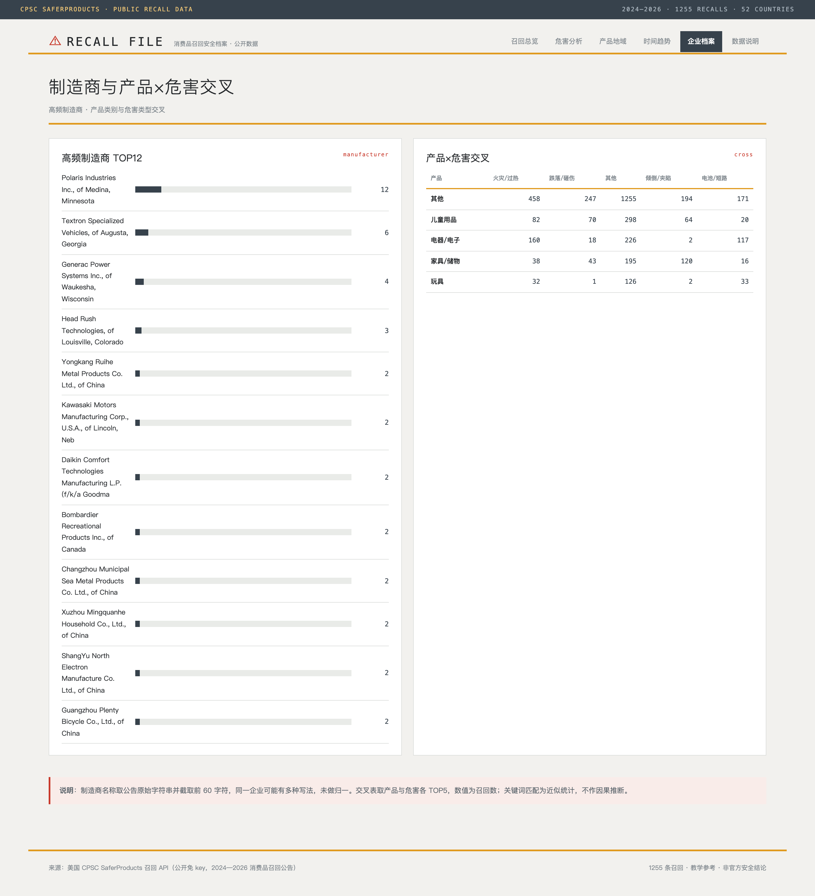
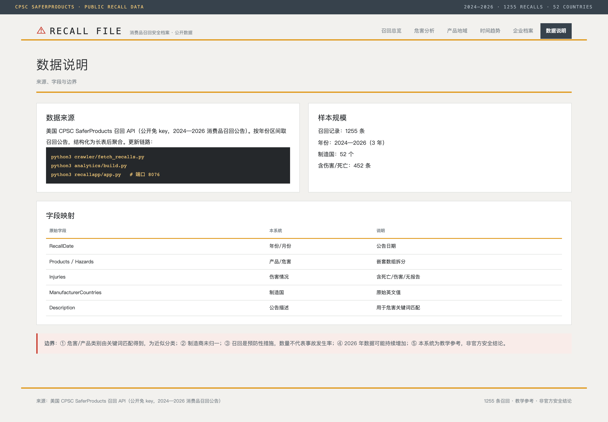

# 076 基于CPSC公开数据的消费品召回分析系统-设计展示

> **代码有偿获取 可接受定制 微信联系方式: csbysj2020 或 ACE2487，备注(BS)**

> **完整源码与全套文档 · 在线自助获取 >>> [https://mbd.pub/o/bread/YZaWmJpwaA==](https://mbd.pub/o/bread/YZaWmJpwaA==)**

> **成品页（功能介绍 / 更多选题）>>> [https://bishe.suilang.net/products/recall-file](https://bishe.suilang.net/products/recall-file)**

> 

> 

## 视频

> **点击查看 >>> [https://www.bilibili.com/video/BV1p7y8zEEPi/](https://www.bilibili.com/video/BV1p7y8zEEPi/)**

## 项目简介

安全档案风格（炭灰、琥珀警示、红、公文卡片），区别于食谱手账/节庆日历/深空雷达。采集 CPSC 公开消费品召回 1255 条（2024—2026、52 制造国），从年度、危害、伤害、产品与地域五维分析。Flask + Chart.js（本地化离线可用），6 个页面。关键词匹配近似与召回预防性质如实标注，非官方安全结论。

消费品召回公告是观察产品安全治理的数据窗口。

本项目设计并实现了一套基于美国 CPSC SaferProducts 公开数据的召回分析系统：通过 REST API 按年份区间获取 1255 条召回记录，摊平产品、危害、伤害与制造商等嵌套字段，从年度趋势、危害类型、伤害情况、产品与制造国五个维度聚合分析。

系统采用 Flask + Chart.js 与安全档案式界面（炭灰、琥珀警示、红、公文卡片），实现召回总览、危害分析、产品地域、时间趋势、企业档案、数据说明 6 个页面。

本仓库为**设计展示**：包含项目说明、技术架构、实验结果与运行截图；完整源码、任务书、开题报告、毕业论文与使用说明可通过上方链接自助获取，成品页可查看更多选题，也可联系微信咨询定制。

## 功能特性

1. 差异化视觉：安全档案（炭灰/琥珀/红/公文卡片），非看板/画廊/手账/日历

2. 真实采集：CPSC SaferProducts API 公开免 key，1255 条召回

3. 五维分析：年度趋势/危害类型/伤害情况/产品类别/制造国

4. 危害画像：火灾过热最常见，452 条含伤害/死亡

5. 产品与地域：关键词分类 + 52 个制造国

6. 企业档案：高频制造商与产品×危害交叉

7. 技术栈差异化：Flask + Chart.js（本地化）

8. 合规边界：关键词近似、召回为预防性措施、非官方安全结论

## 技术架构

| 项目 | 说明 |
| --- | --- |
| 编程语言 | Python 3.8+ |
| Web 框架 | Flask（轻量路由，无 ORM） |
| 图表 | Chart.js（本地化离线可用） |
| 数据源 | CPSC SaferProducts（公开免 key） |
| 样本规模 | 1255 召回 / 52 制造国 |
| 运行端口 | http://127.0.0.1:8076 |
| 说明 | 数据直读 analysis JSON，无需数据库 |

## 目录结构

以下为完整交付版的结构（本仓库仅作设计展示）：

```
recall-file/
├── analytics/
│   └── build.py
├── crawler/
│   └── fetch_recalls.py
├── data/
│   ├── analysis/
│   │   ├── countries.json
│   │   ├── cross.json
│   │   ├── desc_bins.json
│   │   ├── hazards.json
│   │   ├── injuries.json
│   │   ├── manufacturers.json
│   │   ├── months.json
│   │   ├── products.json
│   │   └── years.json
│   ├── processed/
│   │   └── recalls.csv
│   └── stats.json
├── recallapp/
│   └── app.py
├── static/
│   ├── css/
│   │   └── style.css
│   └── vendor/
│       └── chart.umd.min.js
├── templates/
│   ├── about.html
│   ├── base.html
│   ├── companies.html
│   ├── hazards.html
│   ├── overview.html
│   ├── products.html
│   └── timeline.html
├── 任务书/
│   └── 毕业设计任务书.docx
├── 开题报告/
│   └── 毕业设计开题报告.docx
├── 最终论文/
│   ├── 图/
│   │   └── fig-arch.png
│   └── 基于CPSC公开数据的消费品召回分析系统设计与实现.docx
├── 演示截图/
└── …
```

## 数据与实验结论

- 真实采集：CPSC SaferProducts API 公开免 key，1255 条召回
- 危害画像：火灾过热最常见，452 条含伤害/死亡
- 产品与地域：关键词分类 + 52 个制造国

## 交付内容

1. 完整源码（Flask 应用 + 采集器 + 分析引擎 + 6 页面）
2. 真实数据（recalls.csv + analysis JSON）
3. 任务书与开题报告（Word）
4. 毕业论文（Word 七章制）
5. 二次开发说明（Word+md）
6. 6 张截图 + 封面 + 演示视频

## 常见问题

**危害分类准确吗？**

由公告文本关键词匹配得到，为近似分类，一条召回可命中多类。

**召回数增加说明质量变差吗？**

不一定，部分因接口收录范围扩展；召回是预防性措施。

**制造国代表质量吗？**

不代表，反映全球供应链结构与 CPSC 管辖范围。

**图表能离线用吗？**

能，chart.umd.min.js 已本地化到 static/vendor/。

## 截图







